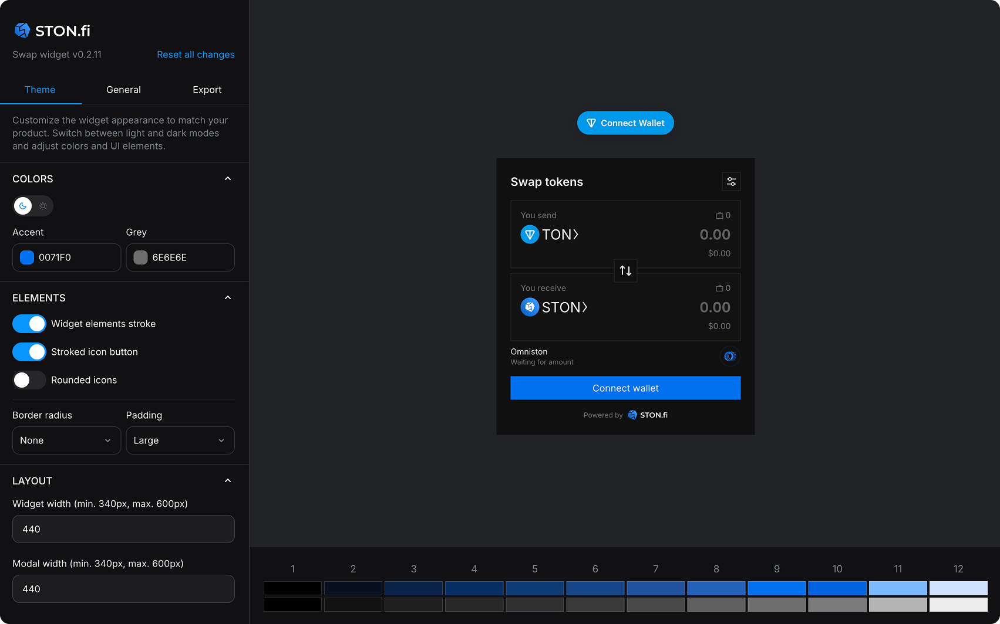

<div align="center" style="margin-bottom: 20px">
  <picture>
    <source media="(prefers-color-scheme: light)" srcset="https://static.ston.fi/branbook/omniston/logo/black.svg" >
    <source media="(prefers-color-scheme: dark)" srcset="https://static.ston.fi/branbook/omniston/logo/white.svg" >
    
  </picture>
</div>

# STON.fi Widget

The STON.fi Widget adds a swap interface for the TON blockchain to your application or website with minimal configuration. Powered by [Omniston](https://docs.ston.fi/developer-section/omniston), it handles wallet connection, quotes, and swap execution. You can collect integrator fees, choose available assets and the initial trading pair, and customize the appearance to match your product.

## Documentation

For complete documentation, including detailed configuration options, API reference, and integration guides, please visit **[https://docs.ston.fi/developer-section/widget](https://docs.ston.fi/developer-section/widget)**

## Visual constructor

Use the [visual constructor](https://widget.ston.fi/constructor) as a playground to try the widget or as a configuration UI for your integration. Preview your changes as you configure the widget.



The constructor provides:

- **Theme customization**: configure light and dark themes, colors, spacing, borders, and widths.
- **Asset selection**: use the default assets, add custom assets, or define your own list and initial trading pair.
- **Integrator fees**: set the fee recipient and rate.
- **Code export**: copy the generated CSS and JavaScript configuration or a complete HTML example into your project.

## Distribution Model

**This widget code is not distributed as an npm package.** This is an intentional design decision to prevent integrators from installing a fixed version that becomes outdated over time.

**Why?** By serving the widget exclusively via CDN, we ensure that all integrators always receive the latest version with bug fixes, security patches, and new features. Backward compatibility is guaranteed through the version path (`/v0/`, `/v1/`, etc.), so your integration will continue to work while automatically benefiting from updates within the same major version.

## Usage

Load the widget directly via a script tag. The IIFE bundle exposes `OmnistonWidget` as a global variable on `window`.

```html
<script src="https://widget.ston.fi/v0/index.js"></script>
<script type="module">
  const widget = new window.OmnistonWidget(/** **/);

  widget.mount(document.querySelector("#omniston-widget-container"));
</script>
```

**OR**

For applications that need programmatic control over when the widget loads, use this loader package with its `load()` function.

```sh
npm i @ston-fi/omniston-widget-loader
```

```js
import omnistonWidgetLoader from "@ston-fi/omniston-widget-loader";

omnistonWidgetLoader.load().then((OmnistonWidget) => {
  const widget = new OmnistonWidget(/** **/);

  widget.mount(document.querySelector("#omniston-widget-container"));
});
```
